<p align="center">
  
</p>

<h1 align="center">极客空间 · Geek Space</h1>

<p align="center">
  <strong>设备信息与硬件监控工作台</strong><br>
  Windows 桌面端 + Android 移动端 · 个人自用 · 无广告 · 无盈利
</p>

<p align="center">当前版本 <strong>v0.3.0</strong></p>

---

## 📸 界面预览

> 截图为 `geek-space/index.html` 在浏览器中直接渲染的结果（即「演示模式」，使用内置模拟设备档案）。
> 打包后的原生应用展示的是**本机真实采集数据**。

### 概览

实时指标条、多指标趋势曲线、整机功耗分解、环形仪表、设备信息与进程占用排行。

<p align="center">
  <a href="docs/images/dashboard-dark.png">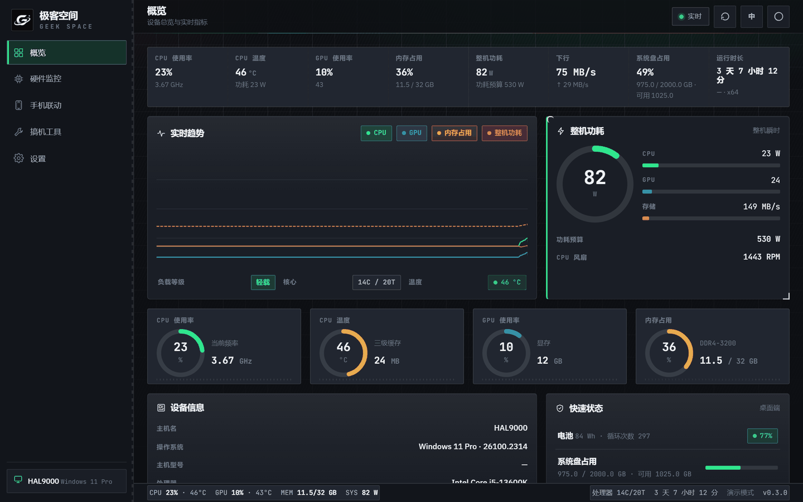</a>
</p>

### 硬件监控

处理器 / 内存 / 显卡 / 主板 / 显示器 / 存储 / 电池 七个页签。

| 处理器规格 + 32 格核心负载矩阵 | 物理盘 · 分区卷 · 实时吞吐 |
|:---:|:---:|
| [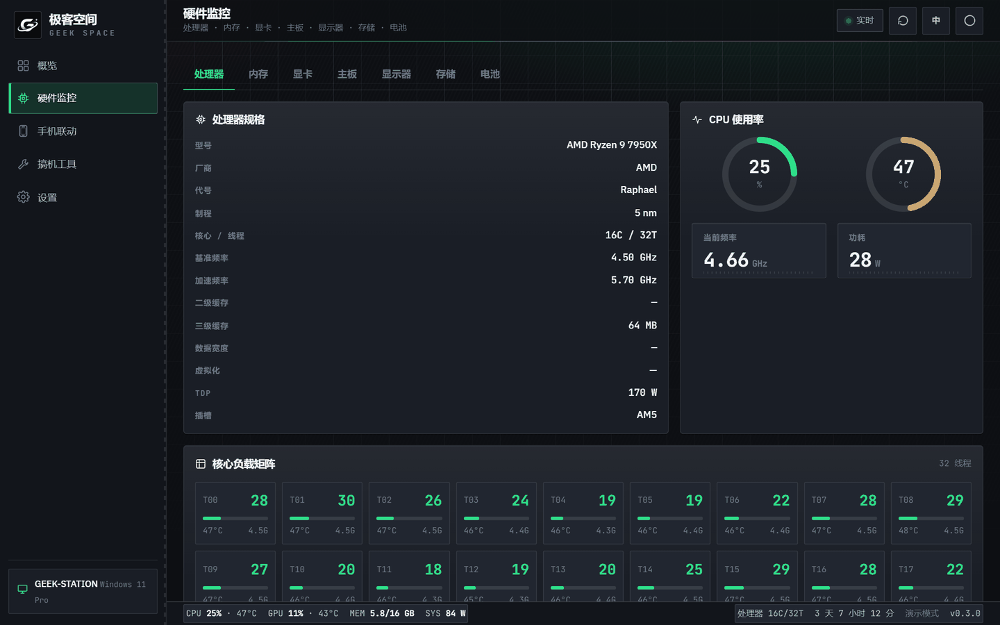](docs/images/monitor-cpu.png) | [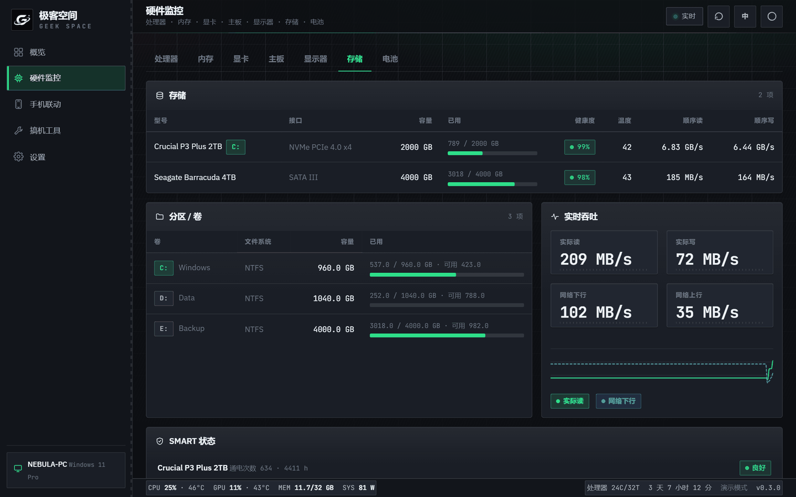](docs/images/monitor-storage.png) |

### 有线连接联动

连接手机后读取设备信息，管理系统应用 / 普通应用（卸载 · 冻结 · 还原，带风险分级），并浏览手机文件。

<p align="center">
  <a href="docs/images/link-phone.png">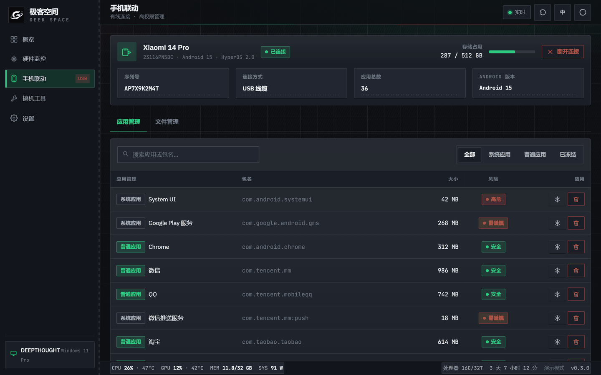</a>
</p>

### 搞机工具

设备跑分、传感器、启动项与服务、驱动与固件。

| 设备跑分（单核 / 多核 / 图形 / 内存） | 启动项与服务（含来源与启用状态） |
|:---:|:---:|
| [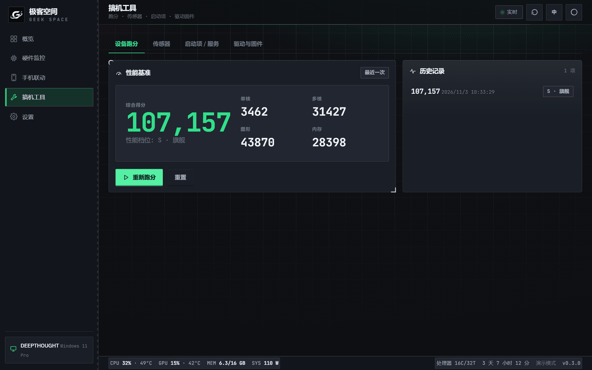](docs/images/tools-bench.png) | [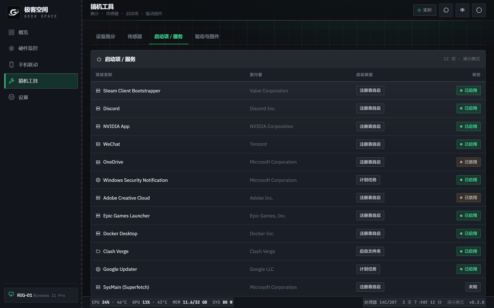](docs/images/tools-startup.png) |

### 六套配色 × 三种桌面视觉风格

| 机械科技（默认） | 简约线条 | 拟物 iOS |
|:---:|:---:|:---:|
| [](docs/images/dashboard-dark.png) | [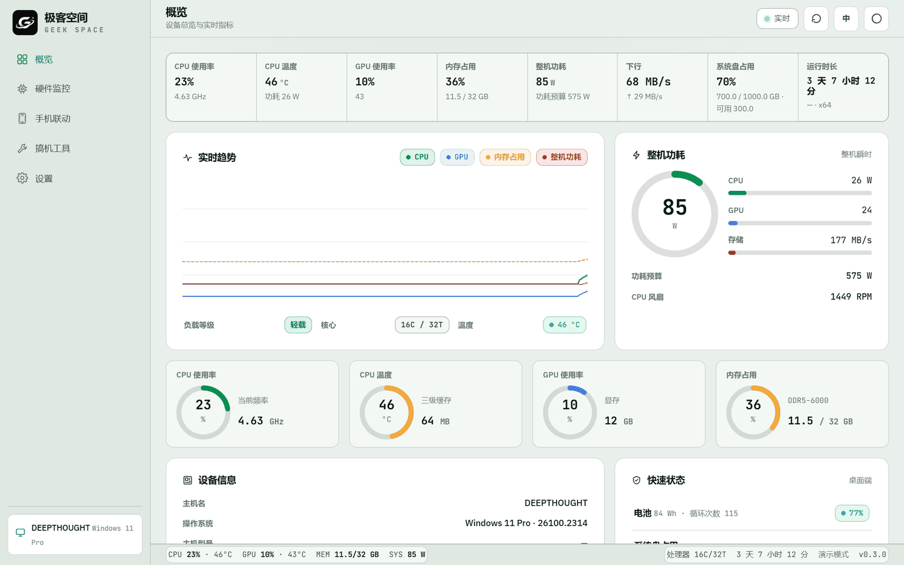](docs/images/style-minimal.png) | [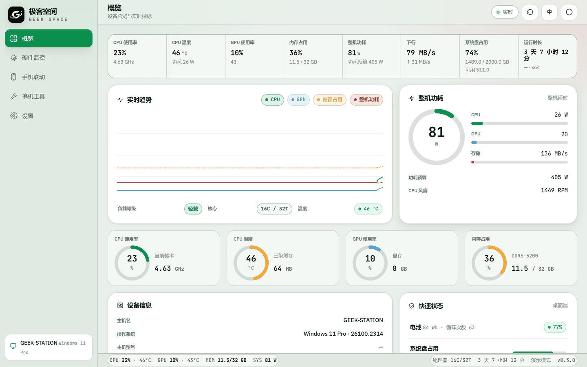](docs/images/style-apple.png) |

配色可在引导页或「设置」中随时切换，共 **6 套配色 × 3 种桌面风格**自由组合（移动端锁定统一风格，避免颜色污染）：

| 六套配色选择器 | 赛博霓虹效果 |
|:---:|:---:|
| [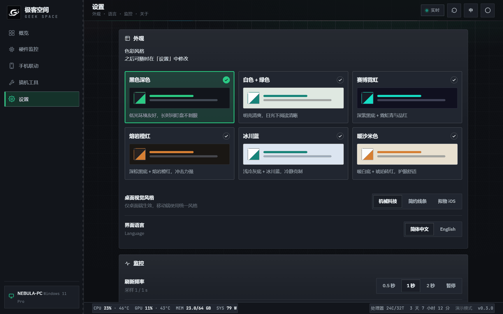](docs/images/settings-colors.png) | [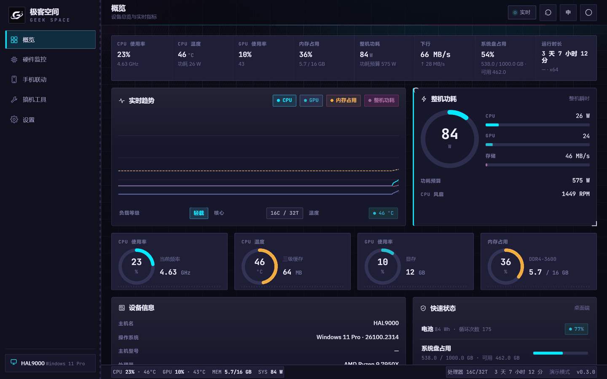](docs/images/theme-cyber.png) |

### 移动端

同一套前端，安卓端自动切换为底部标签栏布局。

| 概览 | 硬件监控 |
|:---:|:---:|
| [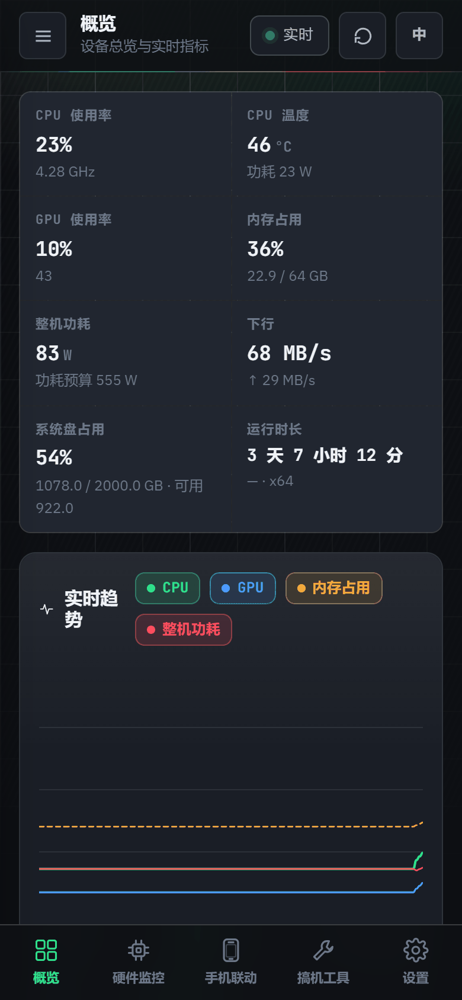](docs/images/mobile-dashboard.png) | [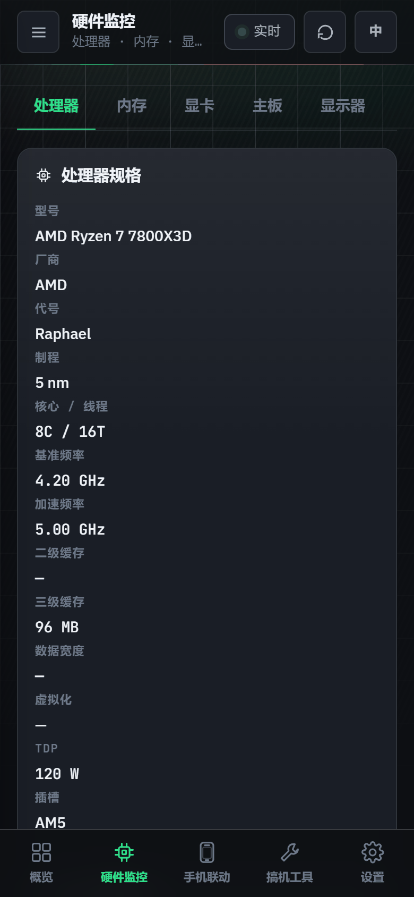](docs/images/mobile-monitor.png) |

### 首次引导

首次打开引导选择色彩风格、语言与桌面视觉风格，之后可在「设置」中修改。

<p align="center">
  <a href="docs/images/onboarding.png"></a>
</p>

---

## 📦 交付产物

| 平台 | 文件 | 大小 | 说明 |
|---|---|---|---|
| Windows | [`极客空间-GeekSpace-0.3.0-安装包.exe`](dist/windows/极客空间-GeekSpace-0.3.0-安装包.exe) | 1.57 MB | NSIS 安装包，当前用户安装，含中英文界面 |
| Android | [`极客空间-GeekSpace-0.3.0-arm64-v8a.apk`](dist/android/极客空间-GeekSpace-0.3.0-arm64-v8a.apk) | 7.17 MB | 已签名 release APK，arm64-v8a，minSdk 24 (Android 7.0+) |

**安装说明**
- Windows：运行安装包按向导安装。
- Android：允许「安装未知来源应用」后直接安装。若提示签名冲突，请先卸载旧的同包名应用。

以上均需系统已装 WebView2 Runtime（Win10 1803+ / Win11 自带）。

---

## 🔍 采集自检工具（新增）

不确定界面上的数字是不是真的？一条命令导出本机实际采集结果：

```powershell
& "$env:LOCALAPPDATA\Geek Space\geek-space.exe" --dump-device D:\device.json
```

输出的 JSON 含 `capabilities` / `profile` / `drivers` / `startup` / `sensors` / `live` 六段，
逐字段列出**这台机器上真实采集到了什么、哪一项读不到**。换机器排查问题直接看这份文件即可。

---

## 目录结构

```
极客空间/
├── geek-space/                 # 前端（框架无关原生 HTML/CSS/JS，也是可直接打开的网页版）
│   ├── index.html
│   ├── assets/logo-mark.png    # 品牌标识（由应用图标同一源图生成）
│   ├── styles/                 # tokens · base · components
│   └── scripts/                # i18n · native · store · monitor · ui · app
├── src-tauri/                  # Tauri 2 后端（Rust）
│   ├── src/
│   │   ├── main.rs             # 入口（release 隐藏控制台；支持 --dump-device 诊断）
│   │   ├── lib.rs              # Tauri command 注册
│   │   ├── collector.rs        # 设备档案 / 实时快照 / 驱动 / 启动项 采集
│   │   └── hw_linux.rs         # Android / Linux 采集层（读 /proc /sys / getprop）
│   ├── capabilities/           # Tauri 权限声明
│   ├── icons/                  # Windows / Android / iOS 全套应用图标
│   ├── tauri.js                # Gradle 调用 CLI 的转发垫片
│   ├── geek-space.keystore     # 本地签名密钥（含私钥，已 .gitignore，不随仓库分发）
│   └── tauri.conf.json
├── tools/                      # 辅助脚本
│   ├── screenshot.js           # 重生成 README 界面截图（Playwright）
│   └── optimize-shots.py       # 截图压缩并输出到 docs/images/
├── build-windows.ps1           # 一键出 Windows 安装包
├── build-android.ps1           # 一键出 Android APK
├── docs/images/                # README 界面截图与应用图标
└── dist/                       # 构建产物（安装包 + APK）
```

---

## 重新生成 README 截图

界面改动后，两条命令重新产出 `docs/images/` 下的全部截图：

```bash
npm install                       # 首次需要（安装 Playwright）
npm run shots                     # 逐视图截图 → .shots/
python tools/optimize-shots.py    # 压缩归档 → docs/images/
```

- 截图由 `geek-space/index.html` 在浏览器中直接渲染（演示模式），使用本机 Edge 内核，不下载 Chromium
- `node tools/screenshot.js bench` 只重截文件名含 `bench` 的项，便于局部更新
- 压缩采用 256 色调色板，体积约为原图的 40%，实测无色带（背景光晕与环形仪表渐变均平滑）

---

## 数据从哪来（逐级降级，任何机器都能跑）

| 优先级 | 平台 | 来源 | 采集内容 |
|---|---|---|---|
| 1 | 全平台 | `sysinfo` crate | CPU 使用率/频率、内存、网络吞吐、进程磁盘 IO、进程占用榜 |
| 2 | Windows | WMI（PowerShell，**启动时 1 次调用**） | CPU 细节、显卡、主板、BIOS、物理盘 + 逻辑卷、内存条、电池、显示器、机箱形态 |
| 3 | Windows | `GetSystemPowerStatus`（Win32 直调） | 电池电量与充放电状态，零进程开销 |
| 4 | Windows | 性能计数器 `\GPU Engine(*)\Utilization Percentage` | **全部显卡**的 3D 引擎利用率 + 专用显存占用 |
| 5 | Windows | `nvidia-smi`（可选） | N 卡的利用率/温度/频率/功耗 + 市场版驱动号 |
| 6 | Windows | **LibreHardwareMonitor** WMI（可选） | 温度 / 风扇 / 电压 / 功耗（真实传感器读数） |
| 7 | Android/Linux | `/proc`、`/sys`、`getprop`、`wm`、`statvfs` | CPU、内存、存储、电池、温度、机型、系统版本 |

**降级原则**：采不到的字段返回 `null`，界面显示「—」或明确原因（「该设备未上报 SMART」「本机未检测到电池」「该设备未开放风扇转速」），**绝不编造**。

---

## 前端如何区分数据源

`scripts/native.js` 检测 `window.__TAURI__`：

- **存在** → 通过 `invoke` 调用 Rust 命令拉取真实数据，状态栏标注「原生采集」
- **不存在** → 走 `monitor.js` 内置模拟引擎，状态栏标注「演示模式」

两套数据源字段完全同构，视图层无需区分，**同一份前端代码同时服务网页版与原生版**。
原生模式下若某类采集返回空，会**清空**列表而非回落到演示样本 —— 演示数据绝不能冒充真机数据。

---

## 视觉系统

### 6 套色彩风格

| ID | 名称 | 特征 |
|---|---|---|
| `dark` | 黑色深色 | 近黑面板分层，绿主色 + 红色辅助强调 |
| `light-green` | 白色+绿色 | 冷白底 + 深绿，高对比正文 |
| `cyber` | 赛博霓虹 | 深紫黑底 + 霓虹青 + 品红 |
| `ember` | 熔岩橙红 | 深棕黑底 + 熔岩橙 + 亮红 |
| `ice` | 冰川蓝 | 浅冷灰底 + 冰川蓝 |
| `sand` | 暖沙米色 | 暖白底 + 琥珀 + 砖红 |

### 3 套桌面视觉风格（差异明显）

| ID | 名称 | 视觉语言 |
|---|---|---|
| `geek` | **机械科技** | 方角硬边、金属拉丝背景 + 工程网格 + 刻度短划、卡片四角括号与左侧色条、硬投影、等宽大写标签 |
| `minimal` | **简约线条** | 无阴影、发丝边框、大留白（内边距 26px）、零装饰 |
| `apple` | **拟物 iOS** | 24px 大圆角、毛玻璃 `backdrop-filter`、顶部内高光、三级柔和阴影、胶囊导航高亮、iOS 风大开关 |

移动端锁定统一视觉风格，避免颜色污染。

---

## 功能实现

### 1. 实时硬件监控
- **概览**：8 项顶部速览条、4 线实时趋势（CPU / GPU / 内存 / 功耗）、整机功耗环形仪表 + 功耗分解、四联环形指标、设备信息、快速状态、**真实进程 TOP 榜**（按 CPU 排序）
- **硬件监控 7 个页签**：处理器 / 内存 / 显卡 / 主板 / 显示器 / 存储 / 电池

### 2. 有线连接联动
设备信息卡片、应用管理（卸载 / 冻结 / 还原 + 风险分级）、文件管理。
⚠️ 当前为交互演示（36 个真实包名样本），原生 ADB 通道待接入。

### 3. 搞机工具箱
设备跑分、传感器查看、启动项（**真实读取注册表 `Run` 与启动文件夹，并从 `StartupApproved` 判定启用/禁用状态，与任务管理器完全互通**）、驱动与固件（**真实读取 `Win32_PnPSignedDriver`**）。

### 4. UI 与设置
首次引导页、6 套配色、3 套桌面风格、中英文切换、温度单位 °C/°F、恢复默认。
左上角 logo、引导页 logo、设置页关于 logo 均与应用图标同源。

---

## 本机真实采集样例（用于对照）

以下是一台实际机器的 `--dump-device` 结果摘要，可作为「正确输出」的参考基准：

| 字段 | 真实值 |
|---|---|
| CPU | `Intel Core i5-6500` · 代号 Skylake · 14 nm · 4C/4T · LGA1151 · 65 W |
| 显卡 | `NVIDIA GeForce GT 730` · 驱动 `475.14` · 2 GB |
| 主板 | `ASUSTeK COMPUTER INC.` / `EX-B150M-V` · 芯片组 Intel B150 · SN `161188176407185` |
| BIOS | `2002` · `2016-09-20` · American Megatrends Inc. |
| 内存 | 16 GB DDR4-2133 · 2 插槽 · Kingston（含料号） |
| 显示器 | `HKC V2411SE` · 24.0" · 1920×1080 · 60 Hz |
| 磁盘 | `WDC WD10EZEX-21WN4A0` 932 GB HDD + `SAMSUNG SSD 830 Series` 119 GB SSD，**系统盘正确指向 SSD** |
| 分区 | `C:` 118.6 GB（83.9% 已用）· `D:` 300 GB · `F:` 316 GB · `G:` 315.5 GB |
| 电池 | 未检测到（台式机，预期行为） |
| GPU 利用率 | `9.9%`（经系统性能计数器取得） |

---

## 构建环境（本机已配置完成）

| 组件 | 版本 | 位置 |
|---|---|---|
| Node.js | v24.14.0 | 已装 |
| Rust | 1.99.1 `stable-x86_64-pc-windows-gnu` | `%USERPROFILE%\.cargo` |
| MSYS2 MinGW-w64 GCC | 16.2.0 | `D:\msys64\msys64\mingw64` |
| JDK | 17.0.20 | `C:\Program Files\Microsoft\jdk-17.0.20.8-hotspot` |
| Android SDK | platform-34 / build-tools 34.0.0 | `%LOCALAPPDATA%\Android\Sdk` |
| Android NDK | r27c | `D:\android-ndk-r27c` |
| Gradle | 9.6.1 | `D:\gradle-9.6.1` |
| WebView2 Runtime | 156.0.4314.58 | 系统已装 |

全部依赖走国内镜像（直连 rust-lang / crates.io / GitHub 均不通）：

- rustup 工具链 → `https://mirrors.tuna.tsinghua.edu.cn/rustup`
- crates 索引 → `sparse+https://mirrors.tuna.tsinghua.edu.cn/crates.io-index/`
- MSYS2 软件包 → `https://mirrors.tuna.tsinghua.edu.cn/msys2/`
- Gradle → `https://mirrors.cloud.tencent.com/gradle/`
- npm → `https://registry.npmmirror.com`

---

## 构建方式

```powershell
# Windows 安装包
powershell -ExecutionPolicy Bypass -File build-windows.ps1

# Android APK
powershell -ExecutionPolicy Bypass -File build-android.ps1
```

两个脚本会自动完成：同步到 ASCII 目录 → 配置工具链 → 编译 → 打包 → 拷回 `dist/` 并清理历史版本。

---

## 构建时踩过的坑（脚本已全部自动处理）

### 中文路径导致 MinGW 链接失败
MinGW 的 `dlltool` / `windres` 按系统 ANSI 代码页处理路径，工作区含中文时乱码。
→ 两个脚本都先把工程同步到 **`D:\build\geek-space`**（纯 ASCII）再编译。
→ 同步时必须用 `robocopy /XD` 排除 `gen`，否则 `/MIR` 会删掉 Android 工程与签名配置。

### NSIS 打包工具下载超时
→ 脚本预先经 `ghfast.top` 代理下载并部署到 `%LOCALAPPDATA%\tauri\NSIS`，同时补齐 `nsis_tauri_utils.dll`（Tauri 会校验 12 个文件的完整性）。

### ICO 格式不被 windres 接受
→ 改用 `tauri icon` 生成标准 BMP 格式 ICO。

### Android 符号链接权限
`tauri android build` 用 symlink 把 `.so` 放进 jniLibs，Windows 非开发者模式不允许。
→ 绕过 tauri CLI，手动复制 `.so` 后直接调 Gradle 打包。

### Android 链接器解析错误
绕过 CLI 后 Rust 会回退到 PATH 里的 MinGW `cc`，其 ld 不认 `--eh-frame-hdr`。
→ `.cargo/config.toml` 显式指定 NDK 的 clang 包装器。

### Tauri Gradle 配置缺失
`tauri.settings.gradle` 等文件只由 `tauri android build` 生成。
→ 脚本先跑一次该命令（预期在符号链接处报错，忽略退出码）以生成配置。

### 连带 BOM 导致 Groovy 解析失败
→ 改用 `[System.IO.File]::WriteAllText` + `UTF8Encoding($false)`。
→ `app/tauri.properties` 同理：带 BOM 会让 Java `Properties` 把 BOM 当成第一个键名。

### PowerShell 把进度信息当成致命错误
PS 5.1 在 `$ErrorActionPreference='Stop'` 下会把原生命令写到 stderr 的正常进度升级为致命错误。
→ 所有外部命令统一经 `cmd /c "... 2>&1"` 调用，并显式检查 `$LASTEXITCODE`。

### PowerShell 按 ANSI 读 UTF-8 文件
`Get-Content -Raw` 会按系统代码页解码，`tauri.conf.json` 里的中文被破坏成非法 JSON。
→ 一律用 `[System.IO.File]::ReadAllText($p, [System.Text.Encoding]::UTF8)`。

### APK 版本号停留在旧值
`app/tauri.properties` 只在 `tauri android build` 时刷新，而本脚本绕过了它。
→ 脚本按 Tauri 同一规则（`major*1000000 + minor*1000 + patch`）重写该文件。

### exe 单独拷出会启动失败（`0xC0000135`）
这个 exe 依赖同目录的 `WebView2Loader.dll`（`webview2-com` 的导入库）。
NSIS 安装包由 Tauri 自己把该 DLL 打进去（见生成的 `installer.nsi` 第 690 行的
`File /a "/oname=WebView2Loader.dll" ...`），所以**装完即可用**；
但若手工只把 exe 拷到别处，会直接报找不到 DLL。
→ 本仓库只交付安装包，不提供便携版，正是为了绕开这个坑。

---

## v0.3.0 修复的核心缺陷（上一版界面为什么会显示错数据）

### 1. PowerShell 包装行的语法错误让**全部 WMI 采集静默失效** ⚠️
`run_ps` 的前缀里有一句：
```powershell
$PSStyle.OutputRendering='PlainText' -ErrorAction SilentlyContinue;
```
`$PSStyle` 只在 PowerShell 7+ 存在。Windows 自带的 5.1 会把它判定为
**语法错误**（`表达式或语句中包含意外的标记"-ErrorAction"`），整条 `-Command` 直接不执行、退出码 1。

后果：显卡、主板、BIOS、显示器、磁盘、驱动、启动项**全部读不到**；
前端拿不到数据就回落到默认值，于是出现「系统盘 0 / 1 GB」这类假数字。

→ 改为版本门控 `if ($PSVersionTable.PSVersion.Major -ge 7) { ... }`。

### 2. 中文输出的编码链路不可靠
PowerShell 默认按系统 ANSI 代码页输出，Rust 按 UTF-8 解析即成乱码。
→ 现在改用 `-EncodedCommand`（UTF-16LE + Base64）传脚本，彻底避开命令行转义；
→ 并在 JSON 末尾把**所有非 ASCII 字符转成 `\uXXXX` 转义**，使输出成为纯 ASCII 字节流。
这样无论控制台代码页是 GBK 还是 UTF-8，字节都不可能被二次编码破坏。

### 3. 系统盘认错盘
原逻辑用 `system: i == 0`（把第 0 块盘当系统盘）。装机常见 HDD+SSD 组合，
第 0 块往往是数据盘。本机第 0 块是 WD 机械盘，系统其实在 SSD 上。
→ 改为由**卷 → 磁盘**映射判定：先定位系统卷（`%SystemDrive%`），再回溯它所在的物理盘。

### 4. 日期字段解析错位
PS 5.1 的 `ConvertTo-Json` 把 `[datetime]` 序列化成 `/Date(1474329600000)/`，
而 Rust 按 `yyyyMMdd` 切片，得到 `"te/Dat"` 这种垃圾（BIOS 日期、驱动日期均中招）。
→ 所有日期在 **PowerShell 侧就格式化成 `yyyy-MM-dd` 字符串**，Rust 侧再兜一层毫秒时间戳解析。

### 5. 布尔字段被当成数字
WMI 的 bool 经 JSON 出来是 `true/false`，而 `n_of` 只认 Number/String，
导致「虚拟化」永远显示为「不支持」。
→ 新增 `b_of()` 处理布尔。

### 6. 驱动列表是噪声
`Win32_PnPSignedDriver` 前几十条全是 `Local Print Queue` 之类的 Microsoft 虚拟设备。
→ 过滤虚拟设备、按厂商/日期排序，显卡网卡声卡驱动排到前面。

### 7. 固件信息是伪造的
驱动与固件页曾**写死** ME 版本号 `16.1.30.2264`，EC 版本永远显示「—」。
→ 删除伪造项。现在只展示**真实采集到的** BIOS 版本 / 日期 / 厂商、主板型号 / 序列号、机箱形态、内存规格。
消费级主板的 EC / ME 版本在 Windows 用户态根本读不到，读不到就不展示。

### 8. Android 侧完全没有采集实现
`collector.rs` 全是 `#[cfg(windows)]` 分支，Android 端采集结果几乎为空。
→ 新增 `hw_linux.rs`：读 `/proc/cpuinfo`、`/proc/meminfo`、`/sys/class/thermal`、
`/sys/class/power_supply/battery`、`sysinfo::Disks`、`getprop`、`wm size`，
**合成与 Windows 完全同构的 JSON**，复用同一套解析逻辑 —— 两端界面因此天然一致。

### 9. 其他
- 「快速状态」里电池 / 风扇显示空洞的破折号 → 改为明确原因文案
- 启动项那个开关只改内存里的布尔值、对系统毫无影响 → 移除误导性控件，改为只读展示真实状态
- 传感器页在无数据时是空白表 → 改为说明如何获得更多传感器
- 进程 TOP 榜是写死的样本 → 改为真实进程（`top_processes` 命令）
- GPU 利用率对 GeForce 老卡读不到 → 增加系统性能计数器兜底（覆盖 Intel / AMD / NVIDIA 全部显卡）

---

## 架构说明（为什么选 Tauri 2）

- **一栈双端**：同一份前端 → Windows `.exe` + Android `.apk`
- **体积小**：不打包 Chromium，复用系统 WebView，安装包 1.57 MB / APK 7.17 MB
- **Rust 后端**：直接调用 Win32 / WMI / 性能计数器 / NVML，无需 Electron 的 Node 中间层
- **前端零重写**：现有 HTML/CSS/JS 直接作为 `frontendDist`

对比同类项目：`adbUI`、`然然玩机工具箱`、`ADB Cleaner` 均采用 Tauri + Rust 方案。

---

## 已知限制

| 项 | 现状 | 说明 |
|---|---|---|
| 温度/风扇/电压 | 需 LibreHardwareMonitor | Windows 用户态无法直接读；未装 LHM 时温度按负载估算并标注「含估算值」 |
| 硬盘 SMART 温度/通电次数 | 显示「—」 | 需 `smartctl` 或管理员权限；健康度取自 `Get-PhysicalDisk.HealthStatus` |
| 显示器面板类型 / HDR | 显示「—」 | EDID 不提供，Windows API 也不暴露 |
| GPU 型号细节（如 GT 730） | 显存/驱动可读，利用率经计数器可得 | 但温度/功耗对 GeForce 老卡不开放，显示「—」 |
| 手机联动 | 交互演示 | 需接入 `adb_client` crate 并捆绑 platform-tools |
| Android 采集维度 | 少于桌面端 | 非 root 下拿不到 SMART、GPU 温度；已按可读范围尽力采集 |
| Android ABI | 仅 arm64-v8a | 如需兼容旧机，改 `build-android.ps1` 的 `$flavor` 为 `Arm` 或 `Universal` |
| 启停启动项 | 只读展示 | 写 `StartupApproved` 属系统级改动，HKLM 项还需管理员权限，未纳入 |
| 应用签名 | 自用 keystore，**不入库** | `build-android.ps1` 首次运行会自动生成本地密钥库（`.gitignore` 已排除 `*.keystore`）。上架前请更换口令，并离线备份私钥 —— 私钥丢失将无法发布同签名更新 |
